# Login Error Handling - State Flow Diagrams

## 1. Complete Authentication State Machine

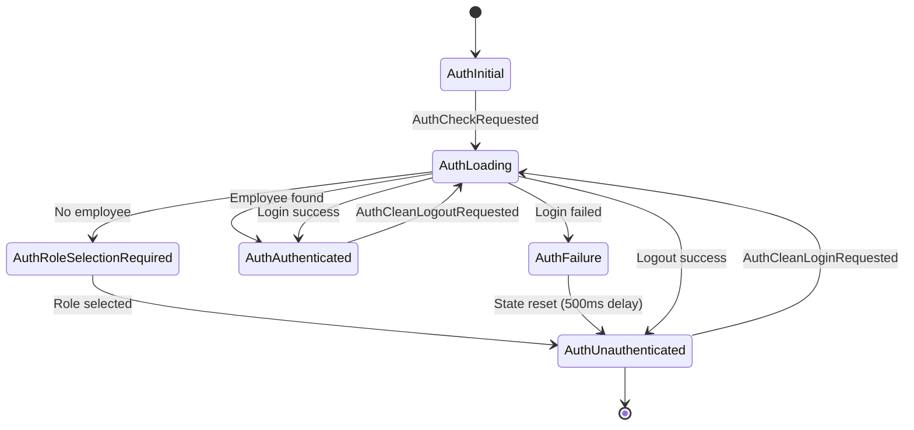

---

## 2. Login Error Recovery Flow (THE FIX)

### Before Fix ❌
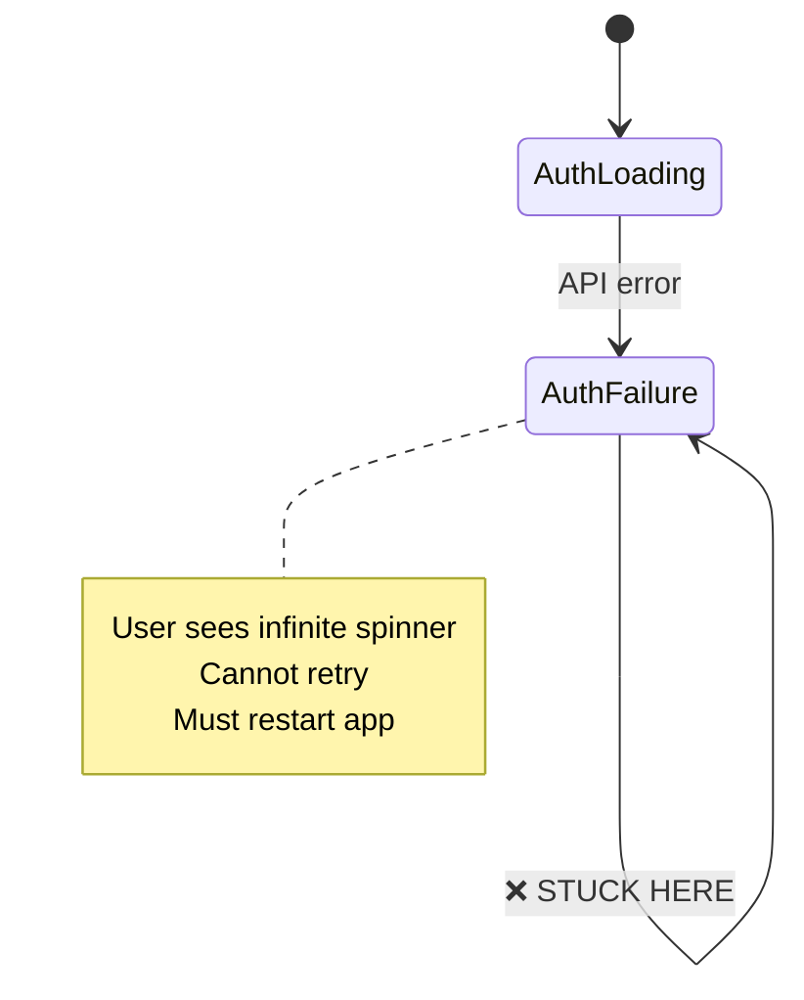

### After Fix ✅
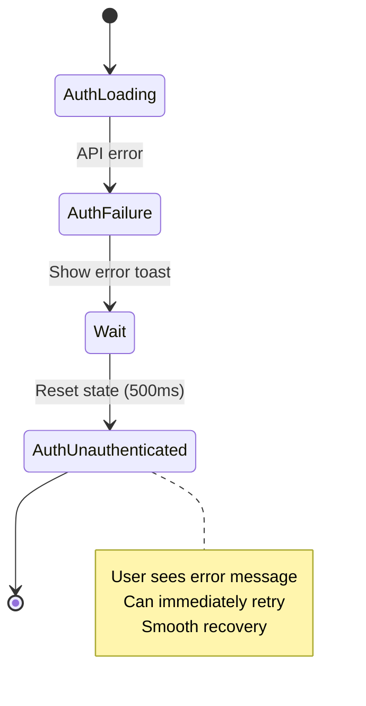

---

## 3. Detailed Login Attempt Flow

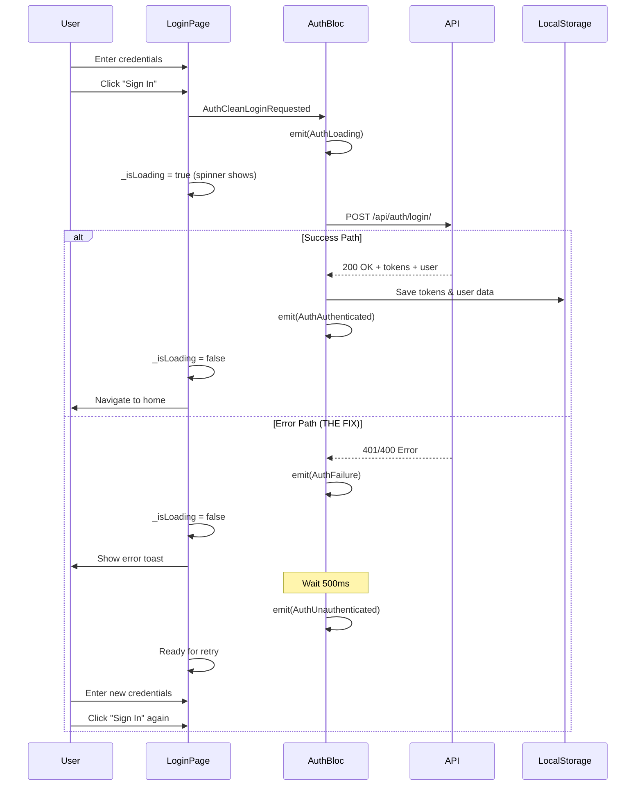

---

## 4. UI State Transitions

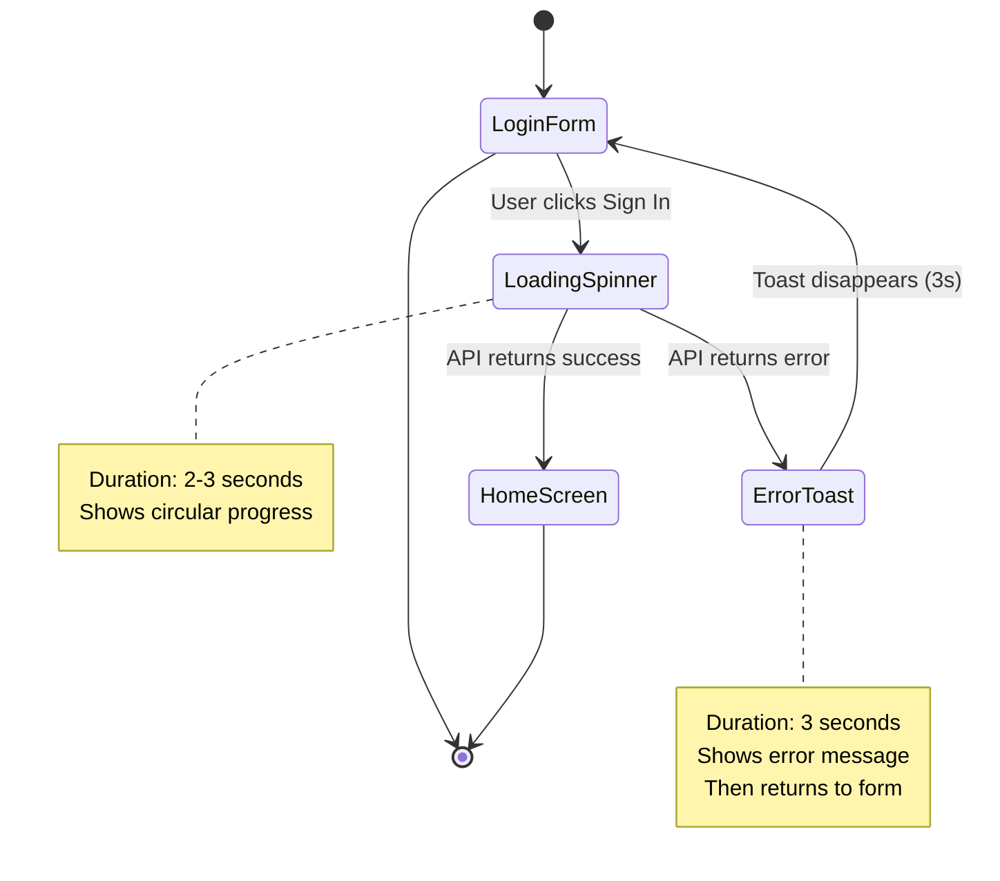

---

## 5. BLoC Event Handling

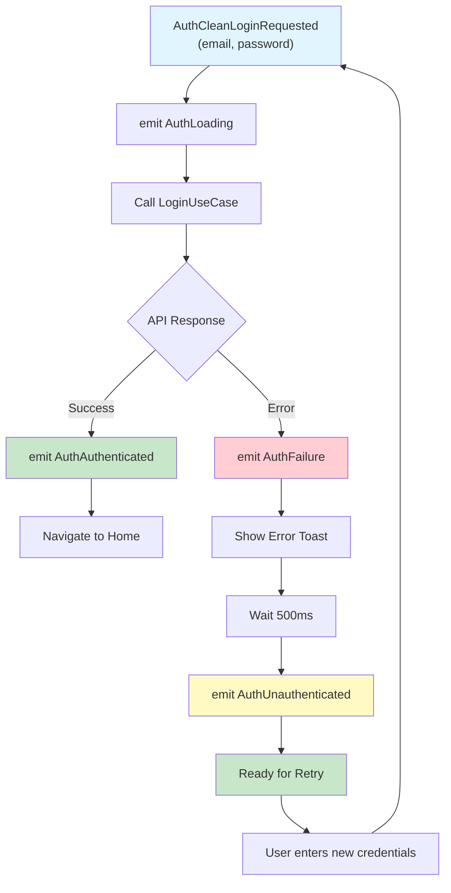

---

## 6. Loading State Management

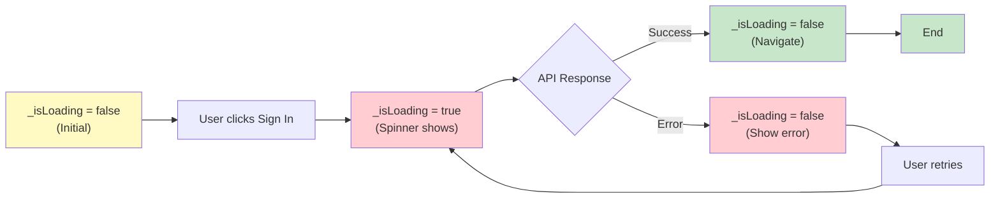

---

## 7. Error Recovery Timeline

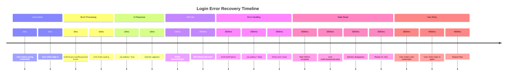

---

## 8. Code Flow Diagram

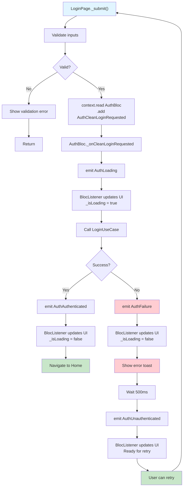

---

## 9. State Listener Logic

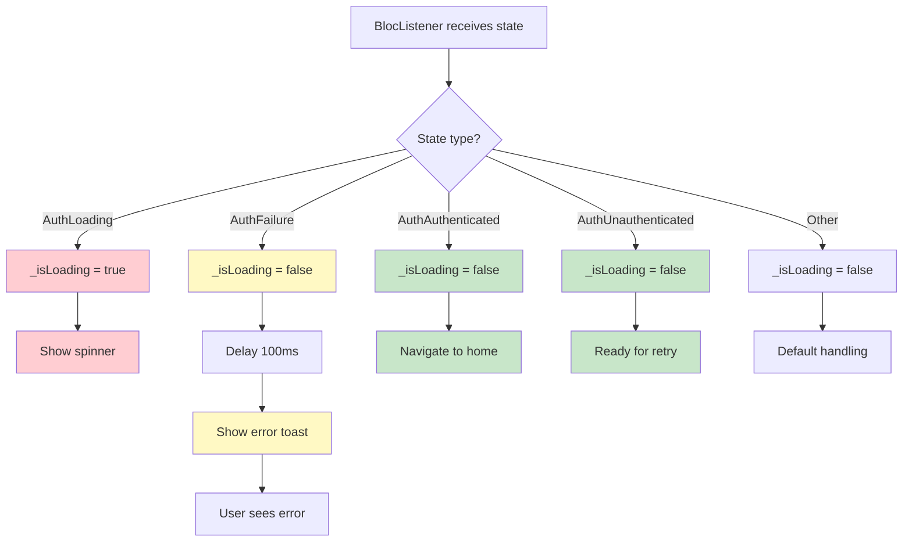

---

## 10. Comparison: Before vs After

### Before Fix ❌
```
User Input
    ↓
AuthLoading (Spinner shows)
    ↓
API Error
    ↓
AuthFailure (Error shown)
    ↓
❌ STUCK - No state reset
❌ Spinner keeps spinning
❌ User frustrated
❌ Must restart app
```

### After Fix ✅
```
User Input
    ↓
AuthLoading (Spinner shows)
    ↓
API Error
    ↓
AuthFailure (Error shown)
    ↓
Wait 500ms
    ↓
AuthUnauthenticated (State reset)
    ↓
✅ Ready for retry
✅ Spinner gone
✅ User happy
✅ Smooth recovery
```

---

## 11. Component Interaction Diagram

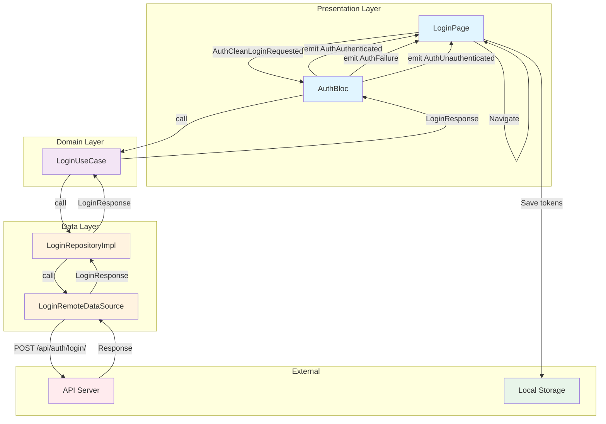

---

## 12. Error Recovery State Machine

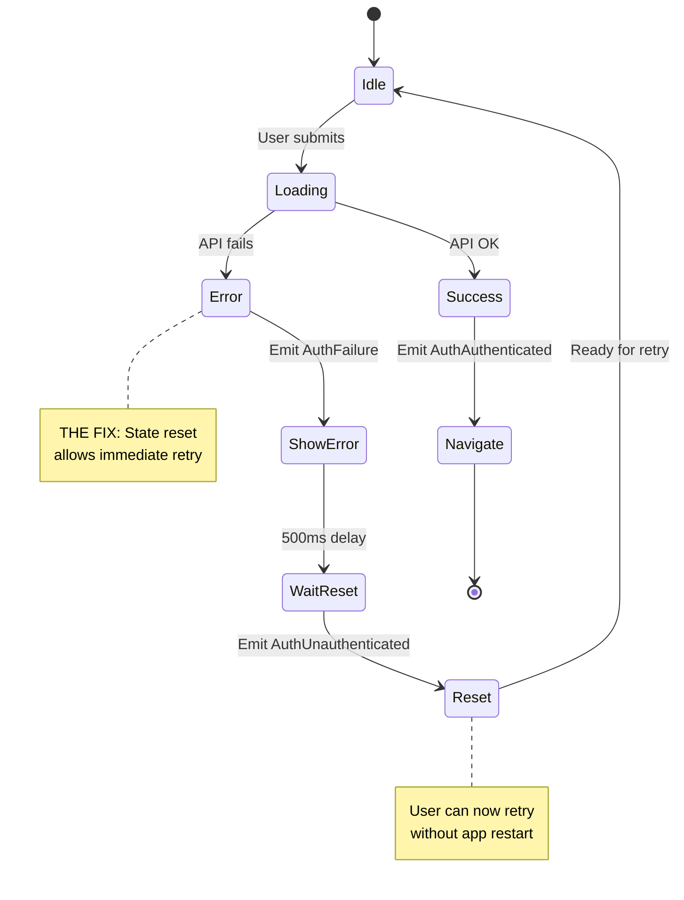

---

## Summary

These diagrams illustrate:

1. **Complete state machine** - All auth states and transitions
2. **Error recovery flow** - Before and after the fix
3. **Sequence diagram** - Detailed interaction between components
4. **UI state transitions** - How UI responds to state changes
5. **BLoC event handling** - Event processing and state emission
6. **Loading state management** - Spinner visibility control
7. **Timeline** - Exact timing of events
8. **Code flow** - Step-by-step execution
9. **State listener logic** - How listener handles each state
10. **Comparison** - Visual before/after
11. **Component interaction** - Layer communication
12. **Error recovery state machine** - Detailed error handling

All diagrams show how the fix enables users to retry login immediately after an error, without infinite loading states.
